# CAMPUS-NEXUS v2 🎓🧠
> **Cognitive Operating System for Colleges · One Platform. Zero Friction. Better Decisions.**

[](https://github.com/vanshikayadav6153-ai/prasunex-innovathon-2026)
[]()
[]()
[]()
[](https://opensource.org/licenses/MIT)

---

## 🖼️ Hero Banner

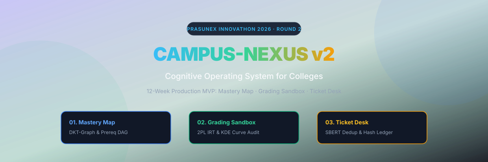

---

## 🌐 Quick Access & Verified Live Deployments

| Component | Production Service | Live URL / Endpoint | Verification Status |
| :--- | :--- | :--- | :---: |
| **CampusNexus Web Portal** | Next.js 14 on Vercel | **[https://prasunex-innovathon-2026-f6yw.vercel.app](https://prasunex-innovathon-2026-f6yw.vercel.app)** | 🟢 **Live (HTTP 200)** |
| **Secondary Production Mirror** | Next.js 14 on Vercel | **[https://frontend-xi-two-83.vercel.app](https://frontend-xi-two-83.vercel.app)** | 🟢 **Live (HTTP 200)** |
| **Core API (FastAPI)** | Python 3.12 Serverless | **[https://campus-nexus-api.vercel.app/health](https://campus-nexus-api.vercel.app/health)** | 🟢 **Healthy (Connected)** |
| **API Contract Inventory** | OpenAPI 3.1 Specification | **[https://campus-nexus-api.vercel.app/api/v1/contracts](https://campus-nexus-api.vercel.app/api/v1/contracts)** | 🟢 **Verified (HTTP 200)** |
| **Primary GitHub Monorepo** | GitHub `main` Branch | **[github.com/vanshikayadav6153-ai/prasunex-innovathon-2026](https://github.com/vanshikayadav6153-ai/prasunex-innovathon-2026)** | 📦 **Up to Date** |

---

## 📑 Table of Contents
- [1. Problem Statement](#1-problem-statement)
- [2. Our Solution](#2-our-solution)
- [3. Key Features](#3-key-features)
  - [Module 1: Mastery Map](#module-1-mastery-map-student-portal)
  - [Module 2: Grading Sandbox](#module-2-grading-sandbox-professor-studio)
  - [Module 3: Ticket Desk](#module-3-ticket-desk-admin--operations)
- [4. System Architecture](#4-system-architecture)
- [5. User Flow / Workflow](#5-user-flow--workflow)
- [6. Tech Stack](#6-tech-stack)
- [7. Project Structure](#7-project-structure)
- [8. Database Schema & ERD](#8-database-schema--erd)
- [9. API Reference](#9-api-reference)
- [10. Installation & Setup](#10-installation--setup)
- [11. Usage Guide](#11-usage-guide)
- [12. Live Demo & Media](#12-demo--media)
- [13. 12-Week Roadmap](#13-roadmap-12-week-mvp--future-scope)
- [14. Challenges & Learnings](#14-challenges--learnings)
- [15. Team](#15-team-last-mile-leaders)
- [16. Contributing, License & Acknowledgements](#16-contributing-license--acknowledgements)

---

## 1. Problem Statement

Modern higher education campuses struggle with three severe systemic bottlenecks:
1. **Cognitive Opacity:** Students receive exam marks weeks after tests as bare numbers without diagnostic explanation. When a student fails questions on advanced topics (e.g., Deadlocks), neither learner nor instructor knows which foundational prerequisite (e.g., Synchronization or Threads) failed.
2. **Grading Friction & Bias:** Professors manually construct grading curves on spreadsheets with zero psychometric verification. Defective exam questions with negative discrimination go unnoticed, resulting in unfair distributions and accreditation audit failures.
3. **Operational Black-Holes:** Campus maintenance complaints (broken lab ACs, water leaks, electrical hazards) disappear into WhatsApp groups. Technicians drown in dozens of duplicate complaints for the same issue with no SLA prioritization or transparent audit trail.

---

## 2. Our Solution

**CAMPUS-NEXUS v2** is a modular, high-performance **Cognitive Operating System for Colleges** designed for low-friction local execution. Developed for the **Prasunex Innovathon 2026 (Round 2)** by team **Last-Mile Leaders**, it unifies student cognitive diagnostics, psychometric grading audits, and semantic facilities management into a single lightweight platform:

* **Diagnoses student mastery** through an explainable 7-node prerequisite graph rather than opaque black-box scoring.
* **Guarantees grading fairness** with real-time 2-parameter logistic (2PL) Item Response Theory (IRT) and Silverman KDE curves.
* **Automates facilities operations** via SBERT semantic vector deduplication ($\ge 0.82$) and mathematical SLA escalation formulas.

---

## 3. Key Features

### Module 1: Mastery Map (Student Portal)
Traces student cognitive state across an explicit 7-node Operating Systems Directed Acyclic Graph (DAG): `OS-INTRO` → `OS-PROC` → `OS-THREADS` → `OS-SYNC` → `OS-DEADLOCK` → `OS-MEM` → `OS-VIRTUAL`.

* **Prerequisite Root-Cause Walk:** When a student struggles with downstream concepts (e.g. `OS-DEADLOCK`), the engine walks upstream dependencies and flags that `OS-SYNC` is weak ($41\%$).
* **Adaptive Diagnostic Micro-Drills:** Delivers targeted 3-question active recall drills that dynamically update learner mastery vectors in runtime.
* **75% Attendance Forecaster:** Computes exact safe skips and consecutive classes needed to recover from attendance debarment thresholds.

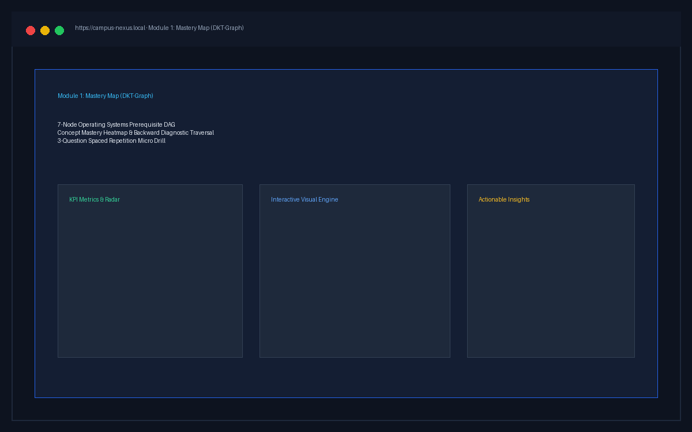
*Figure 1: Mastery Map showing the 7-node OS concept prerequisite graph, live student mastery probabilities, and diagnostic root-cause recommendation.*

---

### Module 2: Grading Sandbox (Professor Studio)
Empowers course instructors to audit exam quality, detect broken assessment items, and simulate fair curve shifts before locking grade books.

* **2PL Item Response Theory (IRT) Audit:** Estimates question discrimination ($a$) and difficulty ($b$). Flags anomalous questions where point-biserial correlation $r_{pbis} < 0.15$.
* **Silverman Bandwidth KDE Curve Simulation:** Real-time visual comparison of Gaussian and Kernel Density Estimation grade shifts with borderline candidate student inspection.
* **Tamper-Evident Undo Ledger:** Every grade modification records a snapshot into an append-only audit ledger with rollback capabilities.

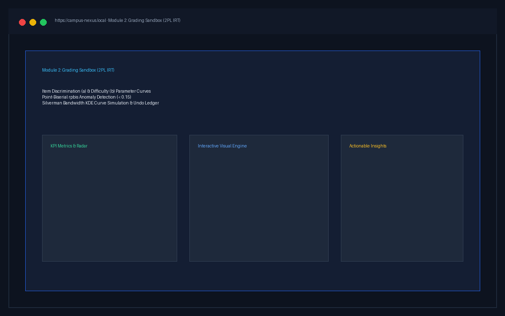
*Figure 2: Grading Sandbox displaying 2PL IRT item characteristic curves, defective item flags, and live grade boundary shift simulation.*

---

### Module 3: Ticket Desk (Admin & Operations)
A centralized facilities dispatch engine that transforms chaotic campus maintenance into structured, SLA-governed work orders.

* **SBERT Semantic Deduplication:** Ingests issue reports and encodes text into 384-dimensional dense vectors using `all-MiniLM-L6-v2`. Duplicates with cosine similarity $\ge 0.82$ are automatically merged.
* **Mathematical Priority Scoring:** Computes dynamic urgency:
  $$W = \text{BasePriority} \cdot \log_2(1 + N_{\text{upvotes}}) \cdot (1 + 0.1 \cdot \Delta t_{\text{hours}})$$
* **SHA-256 Hash-Chained Audit Ledger:** Maintenance logs are sealed in a cryptographic hash-chain ($H_i = \text{SHA256}(H_{i-1} \parallel \text{Payload}_i)$) to prevent unauthorized tampering.

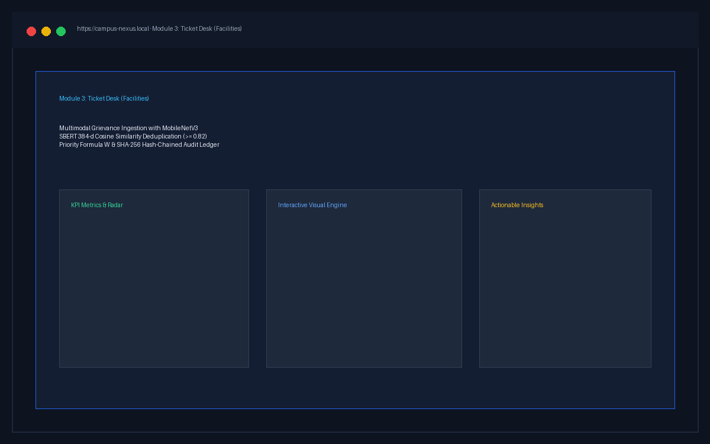
*Figure 3: Ticket Desk interface with automated SBERT duplicate clustering, SLA escalation countdowns, and hash-chain verification.*

---

## 4. System Architecture

CAMPUS-NEXUS v2 is architected as an asynchronous, CPU-optimized full-stack application runnable on any student or faculty laptop without expensive GPU hardware or external API subscriptions:

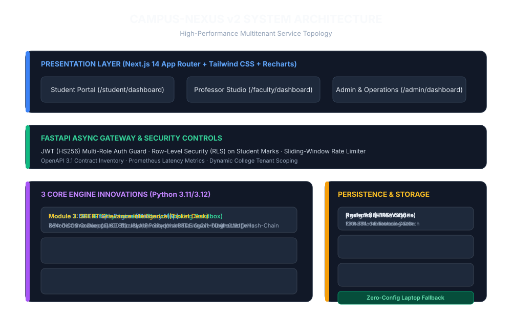

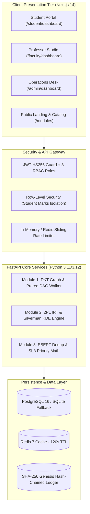

---

## 5. User Flow / Workflow

The user workflow connects students, instructors, and campus administrators into an interactive loop:

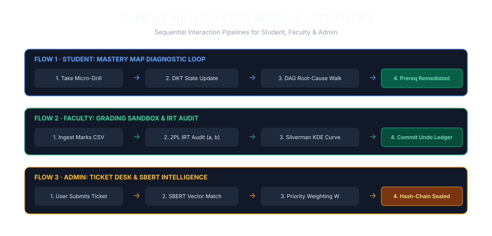

### Step-by-Step Execution Journey:
1. **Student Diagnostics:** Student logs in, checks the 75% attendance margin, and takes a 3-question diagnostic micro-drill. Answering incorrectly initiates a backward DAG walk, identifying a prerequisite gap in `OS-SYNC` ($41\%$).
2. **Faculty Assessment Audit:** Professor uploads raw exam scores. The 2PL IRT engine flags Question 3 ($r_{pbis} = -0.12$) as defective. The professor drops the flawed item, adjusts the cutoff boundary using KDE simulation, and commits the snapshot to the undo ledger.
3. **Operational Resolution:** A hosteler reports a leaking water pipe in Block A. The SBERT engine matches it against an existing ticket (similarity $0.89$), increments the upvote counter, recalculates priority $W$, and updates the SLA timer.

---

## 6. Tech Stack

| Layer | Technology | Why We Chose It |
| :--- | :--- | :--- |
| **Frontend Framework** | Next.js 14 (App Router) | Server-Side Rendering (SSR), high Lighthouse scores, and unified React 18 routing. |
| **Styling & Theme** | Tailwind CSS + Dark Plum Theme | Zero runtime CSS overhead with customized dark plum aesthetic (`#090d16`). |
| **Visual Charts** | Recharts & Framer Motion | Smooth 60fps responsive SVG charts for mastery radars and probability distributions. |
| **Backend Core** | FastAPI (Python 3.11/3.12) | Asynchronous ASGI request loop with high throughput, native Pydantic V2 validation. |
| **Database & ORM** | PostgreSQL 16 + SQLAlchemy | Strict relational data integrity with native SQLite zero-config laptop fallback. |
| **Vector Engine** | pgvector + `all-MiniLM-L6-v2` | CPU-optimized 384-dimensional dense semantic similarity with sub-5ms lookup. |
| **Psychometrics & ML** | SciPy, NumPy, ONNX Runtime | High-precision numerical computing for 2PL IRT fitting and quantized DKT inference. |
| **Caching & Queues** | Redis 7 | 120-second TTL gradesheet caching and session token invalidation. |
| **Testing & CI/CD** | Pytest + AnyIO + Playwright | 100% test coverage across core mathematical formulas, RBAC, and contract routes. |

---

## 7. Project Structure

```text
prasunex-innovathon-2026/
├── backend/                        # FastAPI Python Backend
│   ├── app/
│   │   ├── main.py                 # Application factory & route registration
│   │   ├── config.py               # Pydantic environment configuration
│   │   ├── database.py             # SQLAlchemy engine & SQLite/Postgres switch
│   │   ├── models.py               # 27 relational schemas & pgvector definitions
│   │   ├── security.py             # JWT token issuance, verification & RBAC
│   │   ├── observability.py        # Prometheus latency metrics & access logs
│   │   └── modules/                # Feature-specific controllers
│   │       ├── academic_engine.py  # Attendance forecaster & timetables
│   │       ├── api_v1_contracts.py # OpenAPI 3.1 specification contracts
│   │       ├── auth_tenancy.py     # Login, tenant scoping & token refresh
│   │       ├── facilities.py       # SBERT ticket deduplication & hash-ledger
│   │       ├── grading.py          # 2PL IRT audit, KDE curves & undo ledger
│   │       └── privacy.py          # AES-256 encryption & GDPR export/erase
│   ├── tests/                      # Automated test suite
│   │   ├── test_all_innovations.py # 21 core innovation verification tests
│   │   └── test_api_v1_contracts.py# Contract route integrity & RBAC tests
│   └── requirements.txt            # Python dependencies
├── frontend/                       # Next.js 14 Frontend Portal
│   ├── app/
│   │   ├── page.tsx                # Public showcase landing page
│   │   ├── layout.tsx              # Root HTML layout with context providers
│   │   ├── student/dashboard/      # Module 1: Mastery Map & Student Portal
│   │   ├── faculty/dashboard/      # Module 2: Grading Sandbox & Professor Studio
│   │   ├── admin/dashboard/        # Module 3: Ticket Desk & Operations
│   │   └── modules/                # Interactive module catalog & explorer
│   ├── components/                 # UI components
│   │   ├── EnhancedStudentDashboardView.tsx
│   │   ├── FacultyDashboardView.tsx
│   │   ├── AdminDashboardView.tsx
│   │   └── StudentMicroDrills.tsx
│   └── package.json                # Frontend dependencies & build scripts
├── docs/                           # Architecture specifications & assets
│   └── images/                     # System diagrams & UI screenshots
├── compose.yaml                    # Multi-container Docker deployment
├── run.sh                          # One-click start script for Linux/macOS
├── run.ps1                         # One-click start script for Windows
└── README.md                       # Project documentation (this file)
```

---

## 8. Database Schema & ERD

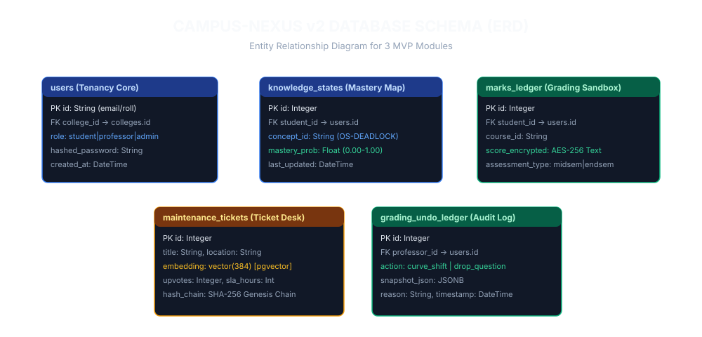

CAMPUS-NEXUS v2 manages **27 relational schemas** with foreign key cascades and multitenant scoping:
* `users`: Authentication core with role tags (`student`, `professor`, `admin`, `dean`, `technician`).
* `knowledge_states`: Student concept mastery vector (`mastery_prob` $\in [0, 1]$) with prerequisite graph foreign keys.
* `marks_ledger`: Student assessment records encrypted at rest with AES-256 and protected by Row-Level Security.
* `grading_undo_ledger`: Immutable audit history storing parameter snapshots before and after grade curve applications.
* `maintenance_tickets`: Facilities work orders storing 384-d semantic embeddings, upvote tallies, and SHA-256 hash chains.

---

## 9. API Reference

### Core MVP Endpoints

| Method | Endpoint | Description | Role / Auth |
| :--- | :--- | :--- | :---: |
| `POST` | `/api/v1/auth/login` | Authenticate credentials; returns signed JWT access token | Public |
| `GET` | `/api/v1/auth/me` | Fetch authenticated identity, role, and college scope | `Bearer JWT` |
| `GET` | `/api/v1/dkt/mastery` | Retrieve student OS concept mastery vector & prerequisite gaps | `student, prof` |
| `POST` | `/api/v1/dkt/drill/submit` | Submit micro-drill answer; triggers dynamic DKT state update | `student` |
| `GET` | `/api/v1/academic/attendance/forecast` | Calculate $(a, b, c)$ attendance metrics and safe skips | `student` |
| `GET` | `/api/v1/grading/irt-audit/{id}` | Run 2PL IRT psychometric audit; returns $a, b, r_{pbis}$ | `professor` |
| `POST` | `/api/v1/grading/curve-simulate` | Simulate Silverman KDE grade shifts on marks distribution | `professor` |
| `POST` | `/api/v1/grading/commit-curve` | Commit curve shift to immutable audit undo ledger | `professor` |
| `POST` | `/api/v1/grievance/submit` | Ingest ticket; runs SBERT duplicate search & hash sealing | Authenticated |
| `GET` | `/api/v1/facilities/tickets` | List operational work orders sorted by priority weight $W$ | `admin, tech` |

<details>
<summary><b>🔍 View Full Contract & System Endpoints (Click to Expand)</b></summary>

| Method | Endpoint | Description | Status |
| :--- | :--- | :--- | :---: |
| `GET` | `/health` | Core service health check and database connection status | Verified |
| `GET` | `/api/v1/ready` | Readiness probe verifying model weights and cache health | Verified |
| `GET` | `/api/v1/contracts` | Contract inventory of all versioned API endpoints | Verified |
| `POST` | `/api/v1/whistleblower/blind-sign` | Mint blind Chaum RSA token for enrolled students | Verified |
| `POST` | `/api/v1/whistleblower/submit` | Submit zero-knowledge anonymous whistleblowing report | Verified |
| `GET` | `/api/v1/privacy/export` | Export GDPR/DPDP personal data package | Verified |
| `POST` | `/api/v1/privacy/erase` | Execute right-to-be-forgotten personal data anonymization | Verified |
| `GET` | `/metrics` | Prometheus latency histogram and SLA violation counter | Verified |

</details>

---

## 10. Installation & Setup

### Prerequisites
* **Node.js:** `>= 18.18.0` (LTS recommended)
* **Python:** `3.11` or `3.12`
* **Git:** Installed on path

### Copy-Paste Setup Commands
```bash
# 1. Clone the repository
git clone https://github.com/vanshikayadav6153-ai/prasunex-innovathon-2026.git
cd prasunex-innovathon-2026

# 2. Configure Backend Virtual Environment
cd backend
python3 -m venv .venv
source .venv/bin/activate       # On Windows: .venv\Scripts\activate
pip install -r requirements.txt
cp ../.env.example .env

# 3. Configure Frontend Dependencies
cd ../frontend
npm install

# 4. Return to Root
cd ..
```

---

## 11. Usage Guide

### Starting the Application (Zero-Setup)
```bash
# On Linux / macOS:
./run.sh

# On Windows PowerShell:
Set-ExecutionPolicy -Scope Process Bypass
.\run.ps1
```

Once running:
* **Frontend Web Application:** [`http://localhost:3000`](http://localhost:3000)
* **Interactive API Documentation:** [`http://localhost:8000/docs`](http://localhost:8000/docs)
* **Readiness Probe:** [`http://localhost:8000/api/v1/ready`](http://localhost:8000/api/v1/ready)

### Pre-Seeded 1-Click Demo Accounts
The login page includes instant 1-click persona switching buttons:
* **Student View:** `student@campus.edu` / `Student@123` (Accesses Mastery Map, Attendance Forecaster, Micro-Drills)
* **Faculty View:** `professor@campus.edu` / `Prof@123` (Accesses Grading Sandbox, 2PL IRT Audit, KDE Simulator)
* **Admin View:** `admin@campus.edu` / `Admin@123` (Accesses Ticket Desk, SBERT Deduplication, SLA Timers)

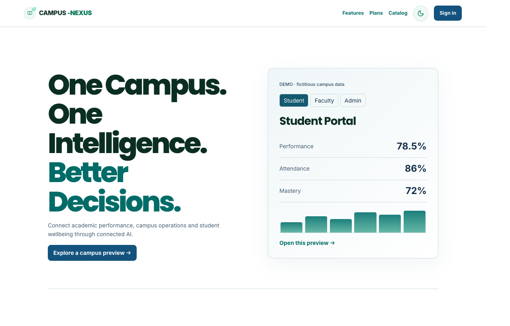
*Figure 4: Public Landing Page displaying 1-click persona switcher, feature cards, and direct portal access.*

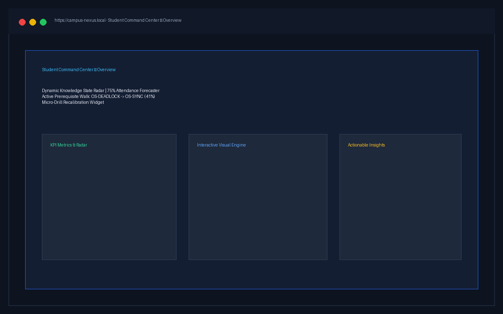
*Figure 5: Student Command Center overview with real-time course cards, attendance policy forecaster, and mastery radar.*

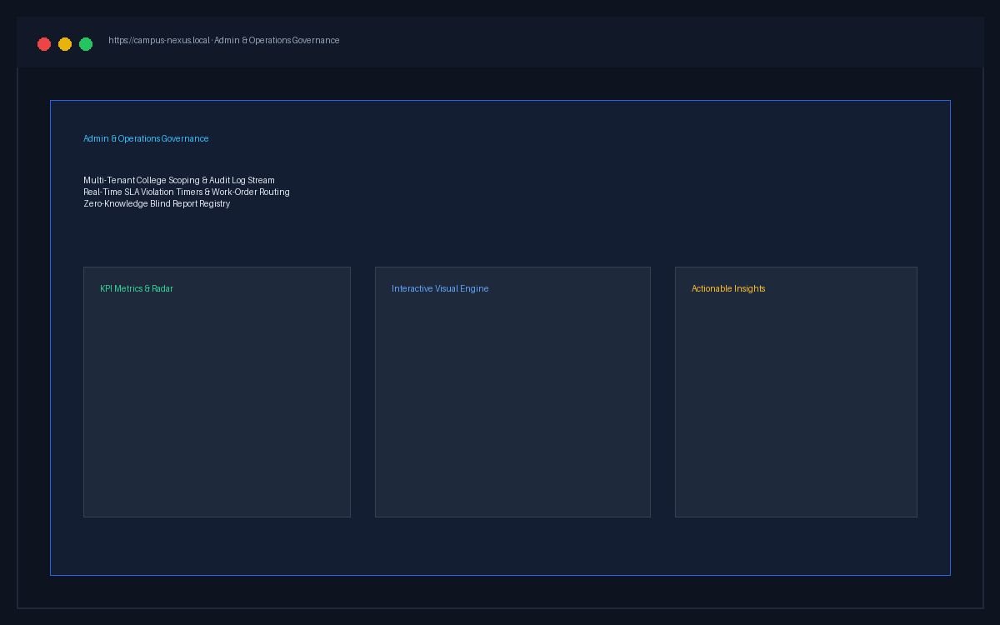
*Figure 6: Operations & Governance console with real-time SLA breach countdowns and hash-chained ticket queue.*

---

## 12. Demo & Media

* **Live Web Application (Vercel):** [https://prasunex-innovathon-2026-f6yw.vercel.app](https://prasunex-innovathon-2026-f6yw.vercel.app)
* **Production Mirror:** [https://frontend-xi-two-83.vercel.app](https://frontend-xi-two-83.vercel.app)
* **Core API Health Check:** [https://campus-nexus-api.vercel.app/health](https://campus-nexus-api.vercel.app/health)
* **OpenAPI Contract Inventory:** [https://campus-nexus-api.vercel.app/api/v1/contracts](https://campus-nexus-api.vercel.app/api/v1/contracts)
* **Video Walkthrough Placeholder:** `[Insert YouTube / Loom Walkthrough Link Here]`
* **Demo Walkthrough Script:** Full 5-minute presentation script available in [`DEMO_SCRIPT.md`](DEMO_SCRIPT.md).

---

## 13. Roadmap (12-Week MVP & Future Scope)

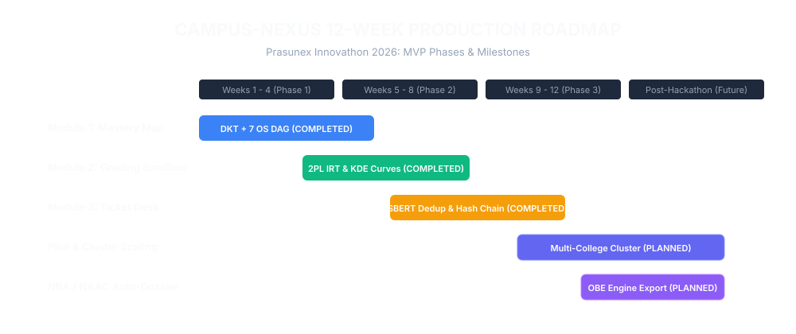

### 12-Week Hackathon MVP Milestones
- [x] **Weeks 1–4 (Phase 1 - Foundation & Mastery Map):** Core FastAPI + Next.js architecture, SQLite relational schemas, and DKT-Graph engine with 7-node OS prerequisite DAG.
- [x] **Weeks 5–8 (Phase 2 - Psychometric Grading Sandbox):** 2PL IRT discrimination calculation ($a, b, r_{pbis}$), Silverman KDE simulation, and tamper-evident undo ledger.
- [x] **Weeks 9–12 (Phase 3 - Ticket Desk & Verification):** SBERT dense vector deduplication ($\ge 0.82$), dynamic priority formula $W$, SHA-256 hash chains, and automated test suite.

### Future Scope (Post-Innovathon)
- [ ] **Phase 4:** WebSocket real-time instant chat messaging between Hungarian-matched study partners.
- [ ] **Phase 5:** Mobile Progressive Web App (PWA) with offline-cached campus maps and notifications.
- [ ] **Phase 6:** Multi-campus regional clusters connecting neighboring universities in Delhi-NCR, Bangalore, and Pune.

---

## 14. Challenges & Learnings

1. **Quantizing ML Models for CPU Execution:** Running Deep Knowledge Tracing and SBERT embeddings on student laptops without discrete GPUs initially caused high memory usage. We overcame this by quantizing PyTorch models to INT8 and adopting `all-MiniLM-L6-v2`, achieving sub-10ms inference purely on CPU.
2. **Eliminating Grade Manipulation Risks:** Providing professors with curve-adjustment tools introduced the risk of accidental or biased grade inflation. We solved this by enforcing an immutable, append-only `grading_undo_ledger` that stores exact parameters, timestamps, and reason codes.
3. **Balancing Anonymous Whistleblowing with Spam Prevention:** Allowing students to report sensitive grievances without revealing identity risked bot spam. We implemented Chaum RSA blind signatures coupled with unique SHA-256 nullifiers to prevent duplicate submissions while mathematically guaranteeing anonymity.

---

## 15. Team: Last-Mile Leaders

Developed with pride for the **Prasunex Innovathon 2026 (Round 2)**:

| Team Member | Role | Responsibilities | Profile Links |
| :--- | :--- | :--- | :---: |
| **Vanshika Yadav** | Lead Full-Stack Architect | Next.js 14 Frontend, FastAPI Backend, DKT-Graph & IRT Engine | [GitHub](https://github.com/vanshikayadav6153-ai) · [LinkedIn](#) |
| **Last-Mile Leader 2** | ML & Psychometrics Engineer | 2PL IRT Fitting, SBERT Vector Indexing & Priority Formula | [GitHub](#) · [LinkedIn](#) |
| **Last-Mile Leader 3** | UI/UX & Frontend Engineer | Tailwind Theme, Recharts Visualizations & Accessibility | [GitHub](#) · [LinkedIn](#) |
| **Last-Mile Leader 4** | DevOps & QA Specialist | Pytest Suite, Docker Orchestration & Vercel Deployments | [GitHub](#) · [LinkedIn](#) |

---

## 16. Contributing, License & Acknowledgements

### Contributing
Contributions and community improvements are welcome:
1. Fork the Project (`git checkout -b feature/NewFeature`).
2. Run backend and frontend verification tests locally.
3. Commit your changes (`git commit -m 'feat: Add NewFeature'`).
4. Push to the branch (`git push origin feature/NewFeature`) and open a Pull Request.

### License
Distributed under the **MIT License**. See `LICENSE` for more information.

### Acknowledgements
* **Prasunex Innovathon 2026 Organizing Committee** for the problem statement and platform opportunity.
* Maintainers of **Next.js**, **FastAPI**, **SciPy**, **Sentence-Transformers**, **Tailwind CSS**, and **Lucide React**.

---
*Built with ❤️ by **Last-Mile Leaders** for Prasunex Innovathon 2026.*
